<div align="center">

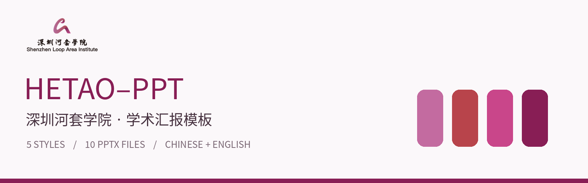

# SLAI-PPT

**深圳河套学院学术汇报模板 · Academic Presentation Templates**

5 种风格 · 10 份可编辑 PPTX · 中英文配套 · 168 页完整预览

[English](README_EN.md) · [模板下载](#模板下载) · [截图示例](#截图示例) · [Logo 与标准色](#logo-与标准色) · [使用说明](#使用说明)

</div>

> 本仓库为个人整理分享，**非学院官方发布**。PPTX、Logo、标准色资料沿用原始压缩包；文件名中的“官方”字样来自源文件，不表示本仓库已核实官方授权。新增脚本文档与第三方素材的许可范围见 [NOTICE.md](NOTICE.md)。

## 模板下载

点击 PPTX 下载可编辑文件；点击 PDF 在线查看整套页面；点击“逐页”查看高清截图。页数包含使用说明及原始隐藏页。

**全部下载：** GitHub 页面右上角 **Code → Download ZIP**。本地解压后可直接打开 [`index.html`](index.html) 浏览、筛选和逐页查看。

| 风格 | 页数（每种语言） | 中文 | English |
| :-- | :--: | :-- | :-- |
| **01 · 波纹学术**<br>Wave | 12 | [](https://github.com/tjl826/SLAI-PPT/blob/main/docs/zh-01.md)<br>[PPTX](https://raw.githubusercontent.com/tjl826/SLAI-PPT/main/downloads/zh-01.pptx) · [PDF](https://github.com/tjl826/SLAI-PPT/blob/main/previews/zh-01.pdf) · [逐页](https://github.com/tjl826/SLAI-PPT/blob/main/docs/zh-01.md) | [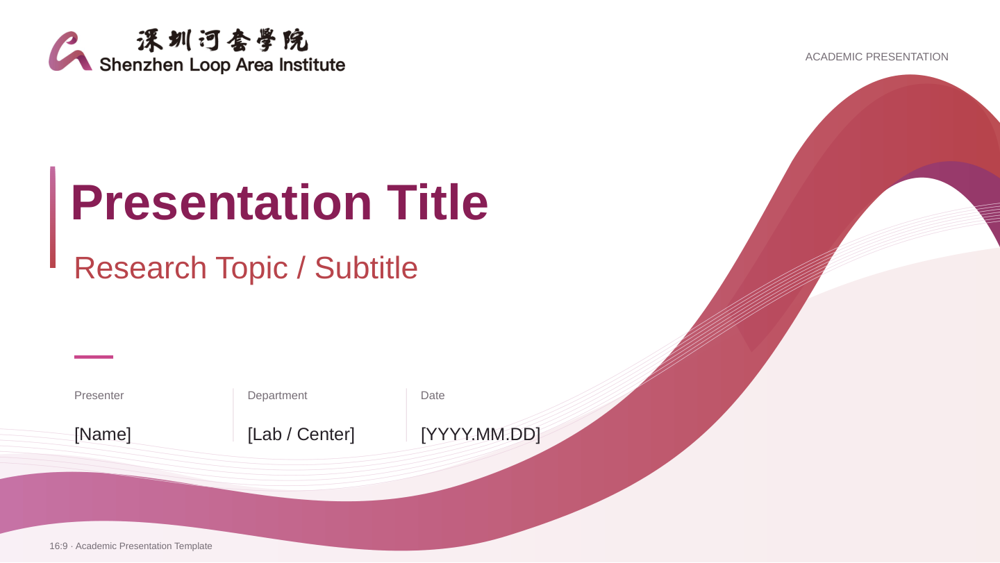](https://github.com/tjl826/SLAI-PPT/blob/main/docs/en-01.md)<br>[PPTX](https://raw.githubusercontent.com/tjl826/SLAI-PPT/main/downloads/en-01.pptx) · [PDF](https://github.com/tjl826/SLAI-PPT/blob/main/previews/en-01.pdf) · [逐页](https://github.com/tjl826/SLAI-PPT/blob/main/docs/en-01.md) |
| **02 · 经典校徽**<br>Classic | 16 | [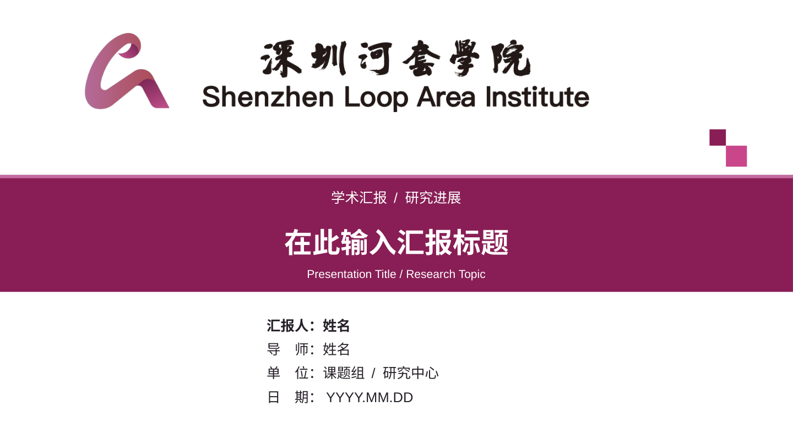](https://github.com/tjl826/SLAI-PPT/blob/main/docs/zh-02.md)<br>[PPTX](https://raw.githubusercontent.com/tjl826/SLAI-PPT/main/downloads/zh-02.pptx) · [PDF](https://github.com/tjl826/SLAI-PPT/blob/main/previews/zh-02.pdf) · [逐页](https://github.com/tjl826/SLAI-PPT/blob/main/docs/zh-02.md) | [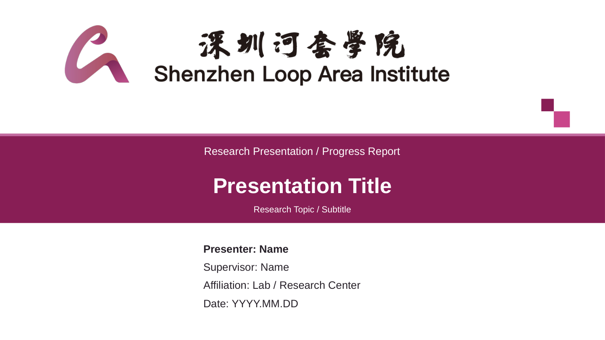](https://github.com/tjl826/SLAI-PPT/blob/main/docs/en-02.md)<br>[PPTX](https://raw.githubusercontent.com/tjl826/SLAI-PPT/main/downloads/en-02.pptx) · [PDF](https://github.com/tjl826/SLAI-PPT/blob/main/previews/en-02.pdf) · [逐页](https://github.com/tjl826/SLAI-PPT/blob/main/docs/en-02.md) |
| **03 · 校园图文**<br>Campus | 28 | [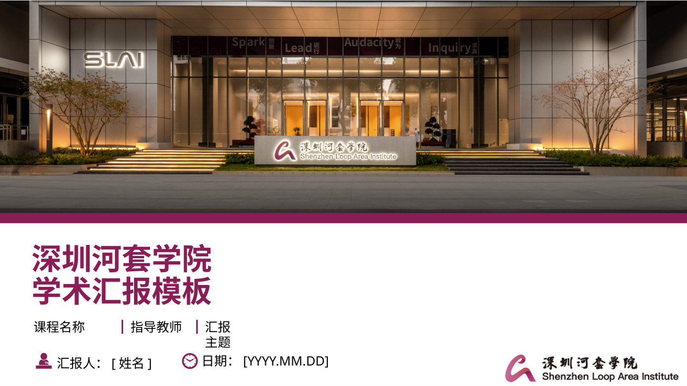](https://github.com/tjl826/SLAI-PPT/blob/main/docs/zh-03.md)<br>[PPTX](https://raw.githubusercontent.com/tjl826/SLAI-PPT/main/downloads/zh-03.pptx) · [PDF](https://github.com/tjl826/SLAI-PPT/blob/main/previews/zh-03.pdf) · [逐页](https://github.com/tjl826/SLAI-PPT/blob/main/docs/zh-03.md) | [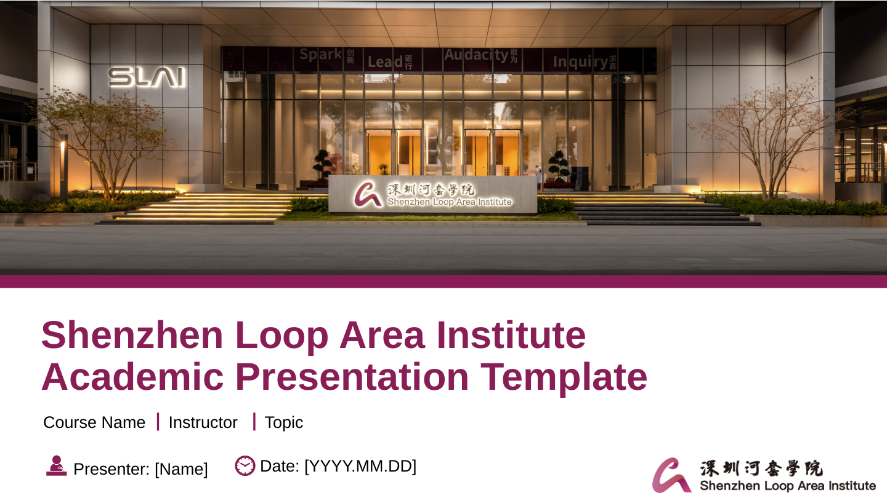](https://github.com/tjl826/SLAI-PPT/blob/main/docs/en-03.md)<br>[PPTX](https://raw.githubusercontent.com/tjl826/SLAI-PPT/main/downloads/en-03.pptx) · [PDF](https://github.com/tjl826/SLAI-PPT/blob/main/previews/en-03.pdf) · [逐页](https://github.com/tjl826/SLAI-PPT/blob/main/docs/en-03.md) |
| **04 · 深色极简**<br>Dark | 14 | [](https://github.com/tjl826/SLAI-PPT/blob/main/docs/zh-04.md)<br>[PPTX](https://raw.githubusercontent.com/tjl826/SLAI-PPT/main/downloads/zh-04.pptx) · [PDF](https://github.com/tjl826/SLAI-PPT/blob/main/previews/zh-04.pdf) · [逐页](https://github.com/tjl826/SLAI-PPT/blob/main/docs/zh-04.md) | [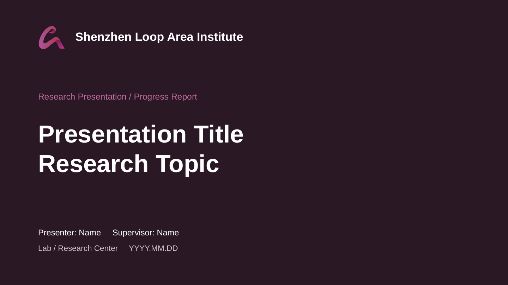](https://github.com/tjl826/SLAI-PPT/blob/main/docs/en-04.md)<br>[PPTX](https://raw.githubusercontent.com/tjl826/SLAI-PPT/main/downloads/en-04.pptx) · [PDF](https://github.com/tjl826/SLAI-PPT/blob/main/previews/en-04.pdf) · [逐页](https://github.com/tjl826/SLAI-PPT/blob/main/docs/en-04.md) |
| **05 · 浅色极简**<br>Light | 14 | [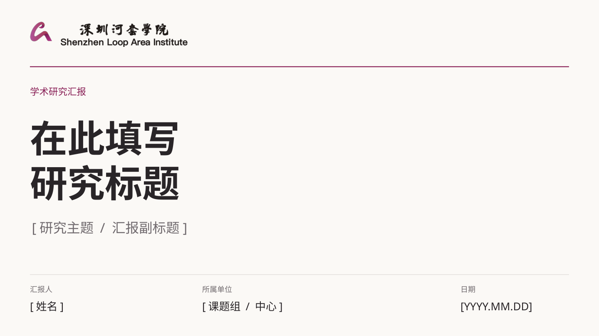](https://github.com/tjl826/SLAI-PPT/blob/main/docs/zh-05.md)<br>[PPTX](https://raw.githubusercontent.com/tjl826/SLAI-PPT/main/downloads/zh-05.pptx) · [PDF](https://github.com/tjl826/SLAI-PPT/blob/main/previews/zh-05.pdf) · [逐页](https://github.com/tjl826/SLAI-PPT/blob/main/docs/zh-05.md) | [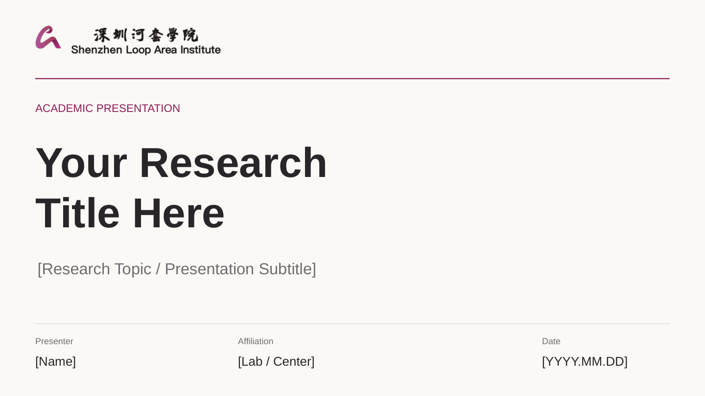](https://github.com/tjl826/SLAI-PPT/blob/main/docs/en-05.md)<br>[PPTX](https://raw.githubusercontent.com/tjl826/SLAI-PPT/main/downloads/en-05.pptx) · [PDF](https://github.com/tjl826/SLAI-PPT/blob/main/previews/en-05.pdf) · [逐页](https://github.com/tjl826/SLAI-PPT/blob/main/docs/en-05.md) |

[查看 10 份模板封面总览](imgs/overview.jpg)

### 风格与内容

| 编号 | 风格 | 适用场景 |
| :--: | :-- | :-- |
| 01 | 波纹学术 / Wave | 适合组会、研究进展与通用学术汇报 |
| 02 | 经典校徽 / Classic | 适合开题、答辩与正式研究汇报 |
| 03 | 校园图文 / Campus | 适合图文叙事、课程展示与综合汇报 |
| 04 | 深色极简 / Dark | 适合简洁的研究展示与专题报告 |
| 05 | 浅色极简 / Light | 适合论文分享、日常汇报与成果交流 |

模板覆盖封面、目录、章节过渡、图文分析、方法框架、对比、图表、表格、研究计划、总结与致谢等版式；具体组合因版本而异。保留源文件中的文本、形状、图表与母版/布局结构，不将整套 PPT 栅格化。建议直接复制需要的页面复用版式，不能假定每套模板都通过同一个母版控制全部元素。

## 截图示例

以下展示 **01 · 波纹学术** 的中英文页面，与参考项目采用相同的“封面—目录—内容—方法—结束”展示思路。其他版本的全部页面见上方“逐页”链接。

| 页面 | 中文 | English |
| :-- | :-- | :-- |
| 首页 / Cover |  |  |
| 目录 / Agenda | 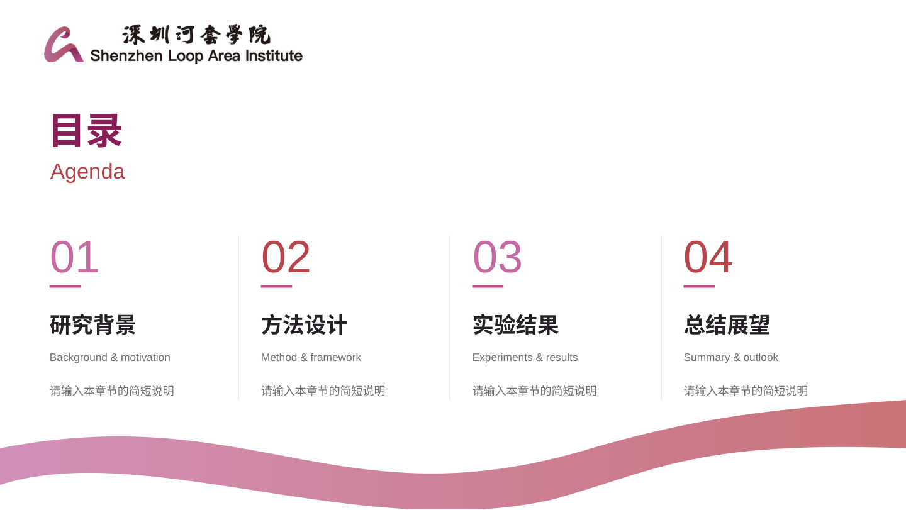 | 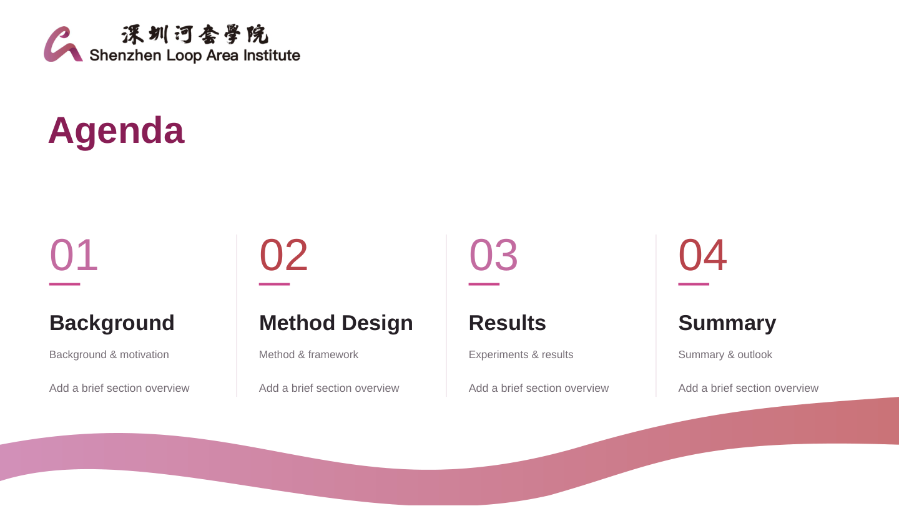 |
| 图文内容 / Content | 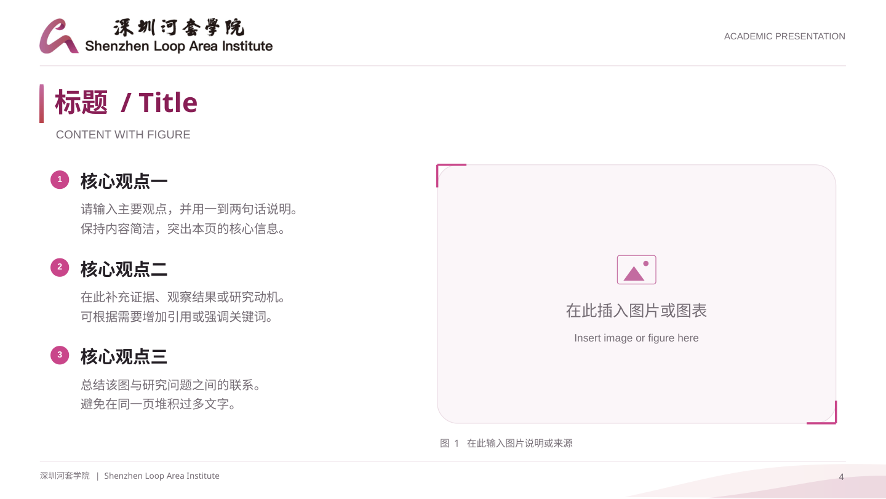 | 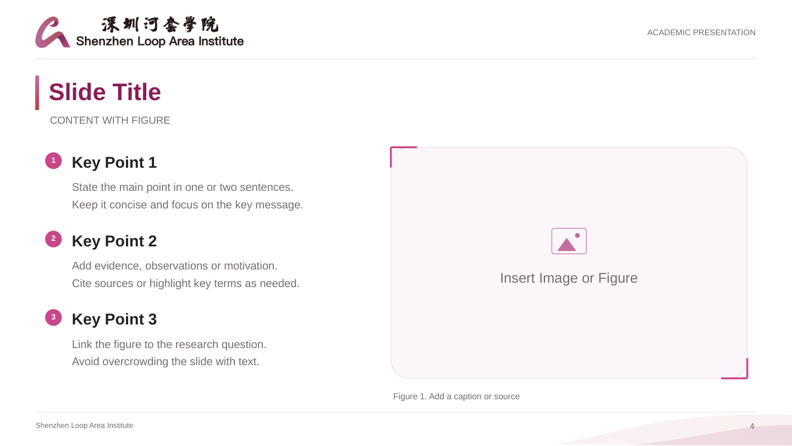 |
| 方法框架 / Method | 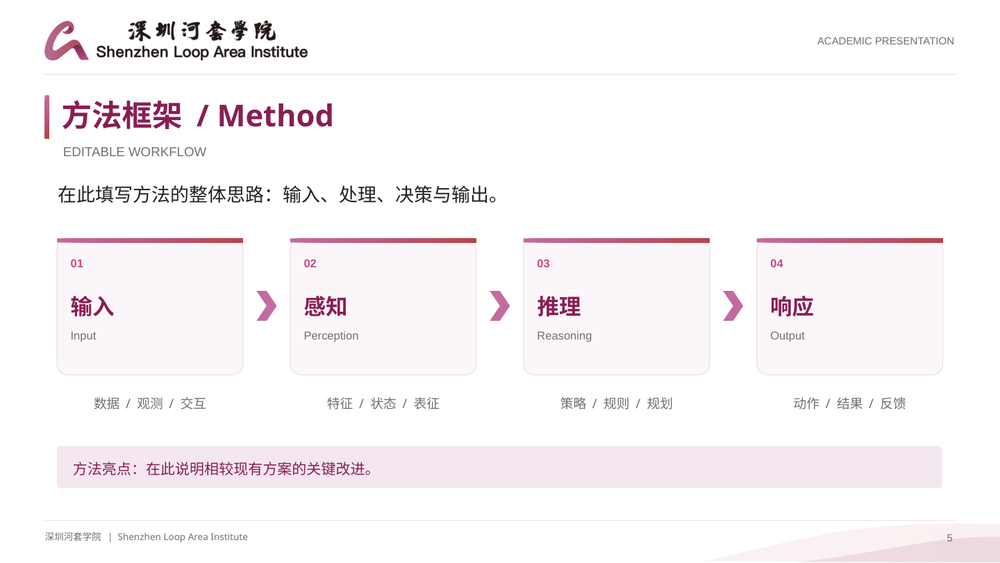 | 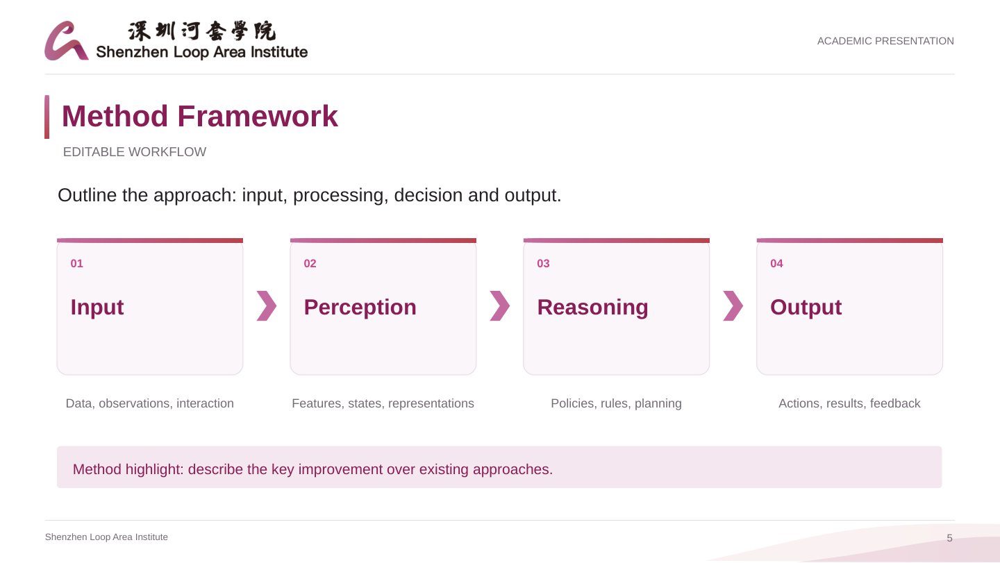 |
| 结束页 / Closing |  | 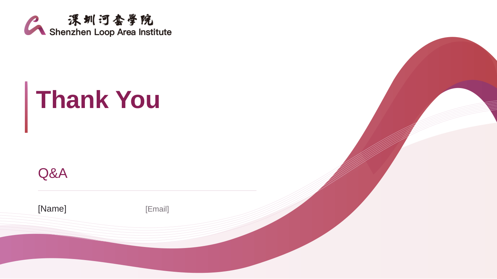 |

## Logo 与标准色


[浏览完整 Logo 目录](%E6%B7%B1%E5%9C%B3%E6%B2%B3%E5%A5%97%E5%AD%A6%E9%99%A2logo/) · [下载标准色 PDF](%E6%A0%87%E5%87%86%E8%89%B2.pdf?raw=true)

| 素材 | 格式 | 文件 |
| :-- | :-- | :-- |
| 中英文字标_矢量版 | SVG | [查看 / 下载](%E6%B7%B1%E5%9C%B3%E6%B2%B3%E5%A5%97%E5%AD%A6%E9%99%A2logo/%E6%B7%B1%E5%9C%B3%E6%B2%B3%E5%A5%97%E5%AD%A6%E9%99%A2_%E5%AE%98%E6%96%B9Logo_%E4%B8%AD%E8%8B%B1%E6%96%87%E5%AD%97%E6%A0%87_%E7%9F%A2%E9%87%8F%E7%89%88.svg?raw=true) |
| 中英文字标_矢量裁切版 | PDF | [查看 / 下载](%E6%B7%B1%E5%9C%B3%E6%B2%B3%E5%A5%97%E5%AD%A6%E9%99%A2logo/%E6%B7%B1%E5%9C%B3%E6%B2%B3%E5%A5%97%E5%AD%A6%E9%99%A2_%E5%AE%98%E6%96%B9Logo_%E4%B8%AD%E8%8B%B1%E6%96%87%E5%AD%97%E6%A0%87_%E7%9F%A2%E9%87%8F%E8%A3%81%E5%88%87%E7%89%88.pdf?raw=true) |
| 中英文字标_透明背景 | PNG | [查看 / 下载](%E6%B7%B1%E5%9C%B3%E6%B2%B3%E5%A5%97%E5%AD%A6%E9%99%A2logo/%E6%B7%B1%E5%9C%B3%E6%B2%B3%E5%A5%97%E5%AD%A6%E9%99%A2_%E5%AE%98%E6%96%B9Logo_%E4%B8%AD%E8%8B%B1%E6%96%87%E5%AD%97%E6%A0%87_%E9%80%8F%E6%98%8E%E8%83%8C%E6%99%AF.png?raw=true) |
| 图形标志_矢量版 | SVG | [查看 / 下载](%E6%B7%B1%E5%9C%B3%E6%B2%B3%E5%A5%97%E5%AD%A6%E9%99%A2logo/%E6%B7%B1%E5%9C%B3%E6%B2%B3%E5%A5%97%E5%AD%A6%E9%99%A2_%E5%AE%98%E6%96%B9Logo_%E5%9B%BE%E5%BD%A2%E6%A0%87%E5%BF%97_%E7%9F%A2%E9%87%8F%E7%89%88.svg?raw=true) |
| 图形标志_矢量裁切版 | PDF | [查看 / 下载](%E6%B7%B1%E5%9C%B3%E6%B2%B3%E5%A5%97%E5%AD%A6%E9%99%A2logo/%E6%B7%B1%E5%9C%B3%E6%B2%B3%E5%A5%97%E5%AD%A6%E9%99%A2_%E5%AE%98%E6%96%B9Logo_%E5%9B%BE%E5%BD%A2%E6%A0%87%E5%BF%97_%E7%9F%A2%E9%87%8F%E8%A3%81%E5%88%87%E7%89%88.pdf?raw=true) |
| 图形标志_透明背景 | PNG | [查看 / 下载](%E6%B7%B1%E5%9C%B3%E6%B2%B3%E5%A5%97%E5%AD%A6%E9%99%A2logo/%E6%B7%B1%E5%9C%B3%E6%B2%B3%E5%A5%97%E5%AD%A6%E9%99%A2_%E5%AE%98%E6%96%B9Logo_%E5%9B%BE%E5%BD%A2%E6%A0%87%E5%BF%97_%E9%80%8F%E6%98%8E%E8%83%8C%E6%99%AF.png?raw=true) |

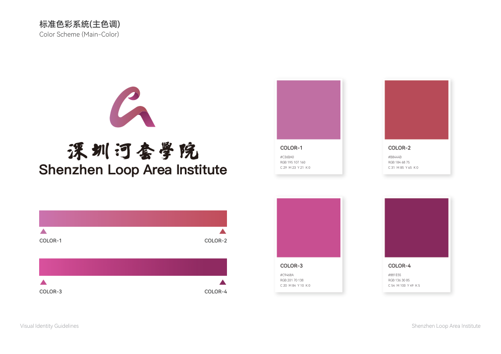

| 色彩 | HEX | RGB |
| :-- | :-- | :-- |
| COLOR 1 | `#C36BA0` | `195, 107, 160` |
| COLOR 2 | `#B8444B` | `184, 68, 75` |
| COLOR 3 | `#C9468A` | `201, 70, 138` |
| COLOR 4 | `#881E55` | `136, 30, 85` |

色值按随包提供的《标准色.pdf》记录；印刷及对外品牌使用请以权利人提供的有效规范为准。

## 使用说明

1. 下载对应语言的 `.pptx`，复制合适的版式并替换占位内容；图表的示例数据不是研究结果。
2. 使用 PowerPoint 打开时，先检查字体与图表。部分文件使用苹方等字体，不同系统可能发生字体替代。仓库不附带或分发字体文件。
3. 使用说明页及部分指南页原本处于隐藏状态。PDF 与截图为了完整展示包含这些页，实际演示前请按需删除或隐藏。
4. Logo、照片、标识和其他素材保留原有权利；使用、修改及公开传播前请确认适用授权。

**原始文件完整性：** [SOURCE_MANIFEST.json](SOURCE_MANIFEST.json) 记录 17 个源文件的路径、大小与 SHA-256。仅清理了 `.DS_Store`、`__MACOSX` 和 `._*` 等系统元数据，源文件字节未修改。

**预览说明：** 全部截图与 PDF 由原始 PPTX 经 LibreOffice 导出，保留所有页面。字体和图表的渲染结果可能与 PowerPoint 略有不同，实际编辑以原始 PPTX 为准。已知源文件问题见 [QUALITY_NOTES.md](docs/QUALITY_NOTES.md)。

## 仓库结构

```text
SLAI-PPT/
├── README.md / README_EN.md     # 项目首页与下载索引
├── *.pptx                      # 10 份原始中英文模板
├── 深圳河套学院logo/            # 6 份原始 Logo 素材
├── 标准色.pdf                  # 原始配色资料
├── imgs/                       # 168 张截图、封面总览与缩略图
├── previews/                   # 10 份完整 PDF
├── docs/                       # 逐页预览、发布与使用说明
├── index.html                  # 可离线打开的浏览页面
├── catalog.json                # 机器可读模板索引
├── SOURCE_MANIFEST.json        # 原始素材校验清单
├── scripts/                    # 预览重建与校验脚本
├── .github/ISSUE_TEMPLATE/      # 问题反馈与模板建议表单
└── publish_to_github.sh         # 建仓与上传脚本
```

## 维护与贡献

欢迎通过 Issues 反馈模板错字、版式或兼容性问题，通过 Pull Requests 提交改进。请注明模板编号、语言、页码及软件版本，并确认新增素材的使用许可。详见 [CONTRIBUTING.md](CONTRIBUTING.md)。

重建预览与本地校验：

```bash
python3 -m pip install -r scripts/requirements-preview.txt
python3 scripts/build_previews.py     # 需要安装 LibreOffice
python3 scripts/verify_repository.py
```

仅检查文件不需要安装额外 Python 依赖。首次发布步骤见 [PUBLISH.md](docs/PUBLISH.md)。

## 致谢与许可

仓库组织及截图展示方式参考 [sysuexam/SYSU-PPT](https://github.com/sysuexam/SYSU-PPT)。本项目没有复制该仓库的中山大学 PPT 或 Logo 文件。

新增脚本及原创仓库文档使用 [MIT License](LICENSE)。**MIT 不覆盖本仓库内的 PPTX 模板、Logo、照片、标准色资料及其派生预览。** 这些文件的权利与适用许可见 [NOTICE.md](NOTICE.md)，不能从参考仓库的许可证推定本仓库素材获得同样授权。
