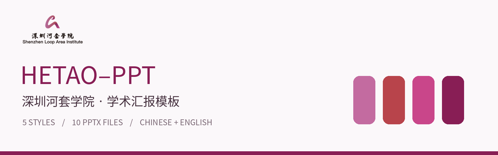
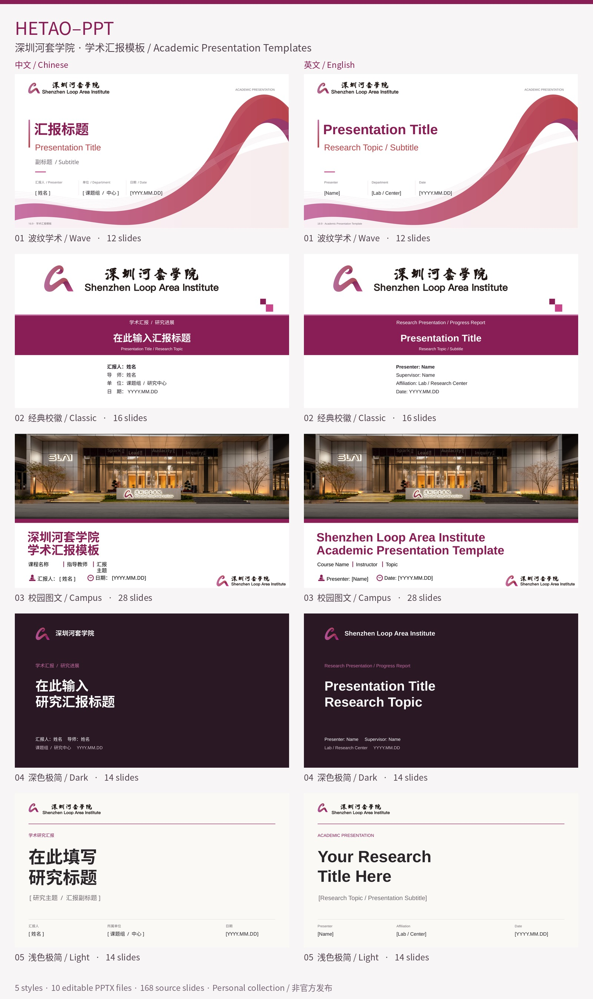

# SLAI-PPT



**Academic presentation templates for 深圳河套学院**

[中文](README.md) · [Offline gallery](index.html) · [Source integrity](SOURCE_MANIFEST.json)

A personal collection of five styles, each in Chinese and English: **10 editable PPTX files and 168 source slides**. This is not an official institutional release. Original material is preserved without changes, except that macOS metadata files are omitted.

## Download and preview

Choose PPTX to edit, PDF for the full deck, or Slides for a page-by-page gallery. Download everything with **Code → Download ZIP**. Open `index.html` after extraction for a local filterable gallery.

| Style | Pages per language | Chinese | English |
| :-- | :--: | :-- | :-- |
| 01 · Wave | 12 | [PPTX](%E6%B7%B1%E5%9C%B3%E6%B2%B3%E5%A5%97%E5%AD%A6%E9%99%A2_%E5%AD%A6%E6%9C%AF%E6%B1%87%E6%8A%A5%E6%A8%A1%E6%9D%BF_%E4%B8%AD%E6%96%871.pptx?raw=true) · [PDF](previews/zh-01.pdf) · [Slides](docs/zh-01.md) | [PPTX](%E6%B7%B1%E5%9C%B3%E6%B2%B3%E5%A5%97%E5%AD%A6%E9%99%A2_%E5%AD%A6%E6%9C%AF%E6%B1%87%E6%8A%A5%E6%A8%A1%E6%9D%BF_%E8%8B%B1%E6%96%871.pptx?raw=true) · [PDF](previews/en-01.pdf) · [Slides](docs/en-01.md) |
| 02 · Classic | 16 | [PPTX](%E6%B7%B1%E5%9C%B3%E6%B2%B3%E5%A5%97%E5%AD%A6%E9%99%A2_%E5%AD%A6%E6%9C%AF%E6%B1%87%E6%8A%A5%E6%A8%A1%E6%9D%BF_%E4%B8%AD%E6%96%872.pptx?raw=true) · [PDF](previews/zh-02.pdf) · [Slides](docs/zh-02.md) | [PPTX](%E6%B7%B1%E5%9C%B3%E6%B2%B3%E5%A5%97%E5%AD%A6%E9%99%A2_%E5%AD%A6%E6%9C%AF%E6%B1%87%E6%8A%A5%E6%A8%A1%E6%9D%BF_%E8%8B%B1%E6%96%872.pptx?raw=true) · [PDF](previews/en-02.pdf) · [Slides](docs/en-02.md) |
| 03 · Campus | 28 | [PPTX](%E6%B7%B1%E5%9C%B3%E6%B2%B3%E5%A5%97%E5%AD%A6%E9%99%A2_%E5%AD%A6%E6%9C%AF%E6%B1%87%E6%8A%A5%E6%A8%A1%E6%9D%BF_%E4%B8%AD%E6%96%873.pptx?raw=true) · [PDF](previews/zh-03.pdf) · [Slides](docs/zh-03.md) | [PPTX](%E6%B7%B1%E5%9C%B3%E6%B2%B3%E5%A5%97%E5%AD%A6%E9%99%A2_%E5%AD%A6%E6%9C%AF%E6%B1%87%E6%8A%A5%E6%A8%A1%E6%9D%BF_%E8%8B%B1%E6%96%873.pptx?raw=true) · [PDF](previews/en-03.pdf) · [Slides](docs/en-03.md) |
| 04 · Dark | 14 | [PPTX](%E6%B7%B1%E5%9C%B3%E6%B2%B3%E5%A5%97%E5%AD%A6%E9%99%A2_%E5%AD%A6%E6%9C%AF%E6%B1%87%E6%8A%A5%E6%A8%A1%E6%9D%BF_%E4%B8%AD%E6%96%874.pptx?raw=true) · [PDF](previews/zh-04.pdf) · [Slides](docs/zh-04.md) | [PPTX](%E6%B7%B1%E5%9C%B3%E6%B2%B3%E5%A5%97%E5%AD%A6%E9%99%A2_%E5%AD%A6%E6%9C%AF%E6%B1%87%E6%8A%A5%E6%A8%A1%E6%9D%BF_%E8%8B%B1%E6%96%874.pptx?raw=true) · [PDF](previews/en-04.pdf) · [Slides](docs/en-04.md) |
| 05 · Light | 14 | [PPTX](%E6%B7%B1%E5%9C%B3%E6%B2%B3%E5%A5%97%E5%AD%A6%E9%99%A2_%E5%AD%A6%E6%9C%AF%E6%B1%87%E6%8A%A5%E6%A8%A1%E6%9D%BF_%E4%B8%AD%E6%96%875.pptx?raw=true) · [PDF](previews/zh-05.pdf) · [Slides](docs/zh-05.md) | [PPTX](%E6%B7%B1%E5%9C%B3%E6%B2%B3%E5%A5%97%E5%AD%A6%E9%99%A2_%E5%AD%A6%E6%9C%AF%E6%B1%87%E6%8A%A5%E6%A8%A1%E6%9D%BF_%E8%8B%B1%E6%96%875.pptx?raw=true) · [PDF](previews/en-05.pdf) · [Slides](docs/en-05.md) |



## Assets and editing

The original [logo assets](%E6%B7%B1%E5%9C%B3%E6%B2%B3%E5%A5%97%E5%AD%A6%E9%99%A2logo/) include PNG, SVG and PDF files. The original [color guide](%E6%A0%87%E5%87%86%E8%89%B2.pdf) is also included.

Duplicate an existing slide to reuse its layout. Native text, shapes, charts and layout/master structures are preserved, but a single slide master does not necessarily control every visual element. Replace placeholder text and sample chart data before presenting.

Previews are generated with LibreOffice and include hidden guide slides. Font substitution and chart rendering may differ from PowerPoint. No font files are distributed. See [quality notes](docs/QUALITY_NOTES.md) for known source issues.

## Reproducibility

```bash
python3 -m pip install -r scripts/requirements-preview.txt
python3 scripts/build_previews.py
python3 scripts/verify_repository.py
```

LibreOffice is required to regenerate PDFs. Verification alone uses the Python standard library. The 17 original source assets are recorded in `SOURCE_MANIFEST.json` with SHA-256 checksums.

## Attribution and licensing

Repository organization and screenshot presentation were inspired by [sysuexam/SYSU-PPT](https://github.com/sysuexam/SYSU-PPT). Its university slides and logos are not redistributed here.

MIT applies only to the newly written repository scripts and original documentation, not to the supplied PPTX files, institutional marks, photographs, color guide or derived previews. See [LICENSE](LICENSE) and [NOTICE.md](NOTICE.md).

This package does not itself establish official endorsement or permissions for institutional assets. Original filenames containing “官方” are retained from the supplied archive, not independently verified.
