# 中文 1 · 波纹学术 / Wave

[返回首页 / Back](../README.md)

[下载 PPTX](../%E6%B7%B1%E5%9C%B3%E6%B2%B3%E5%A5%97%E5%AD%A6%E9%99%A2_%E5%AD%A6%E6%9C%AF%E6%B1%87%E6%8A%A5%E6%A8%A1%E6%9D%BF_%E4%B8%AD%E6%96%871.pptx?raw=true) · [完整 PDF](../previews/zh-01.pdf) · [缩略图总览](../imgs/zh-01/contact-sheet.jpg)

共 12 页。隐藏页也包含在本预览中，PPTX 原始隐藏状态不变。

预览由 LibreOffice 自动导出；字体替代或图表渲染可能与 PowerPoint 略有差异，以下载的原始文件为准。

## 01

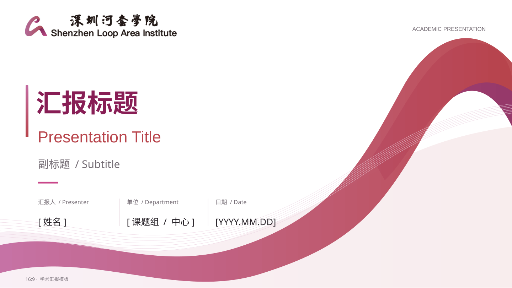

## 02

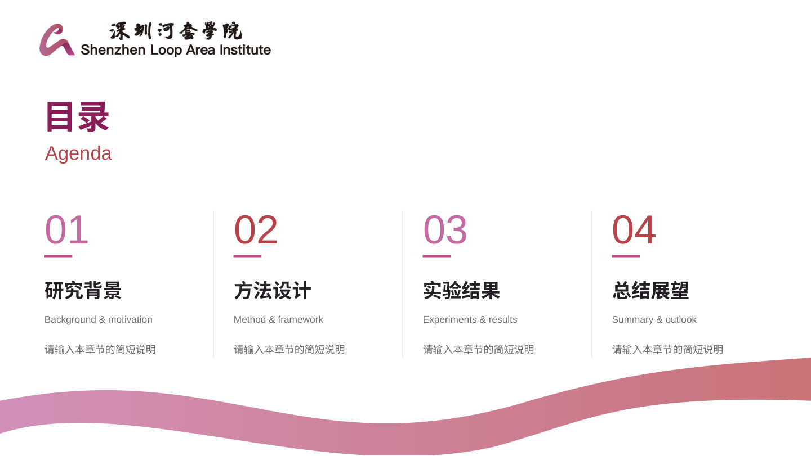

## 03

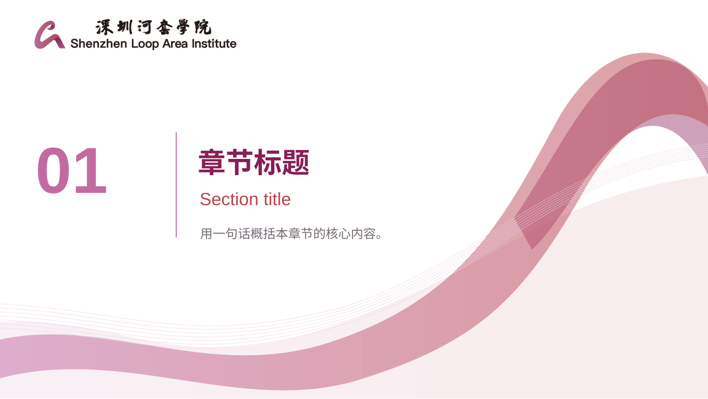

## 04

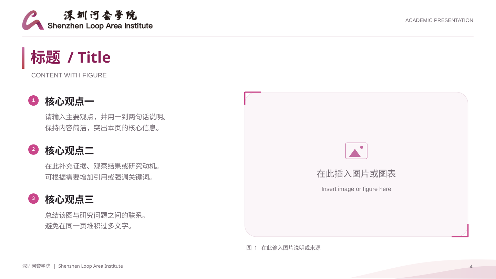

## 05

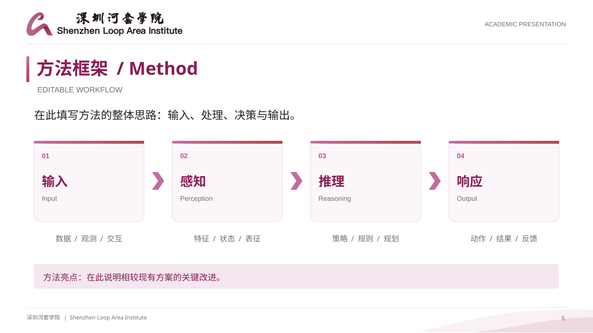

## 06

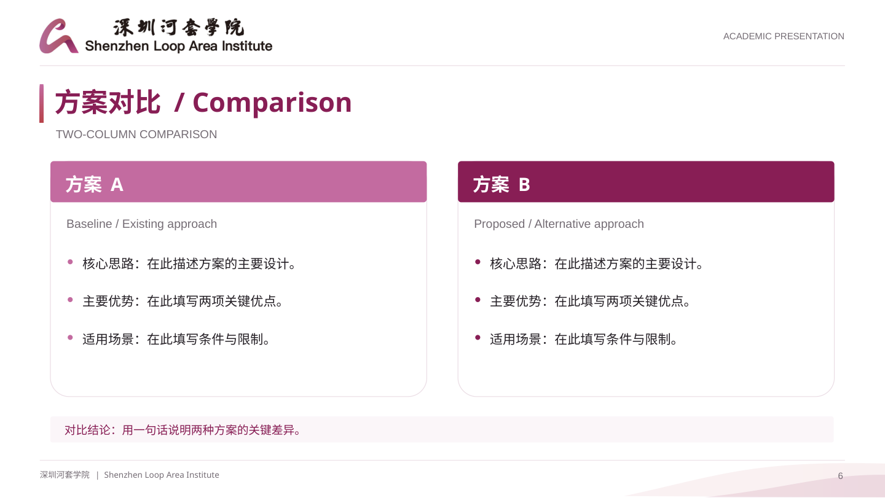

## 07

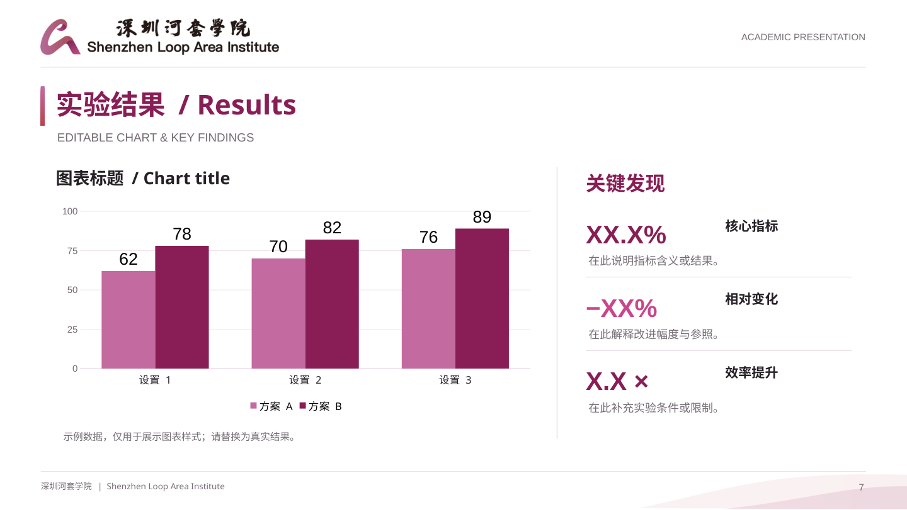

## 08

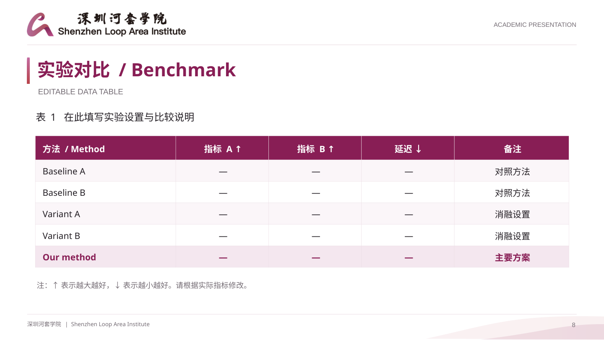

## 09

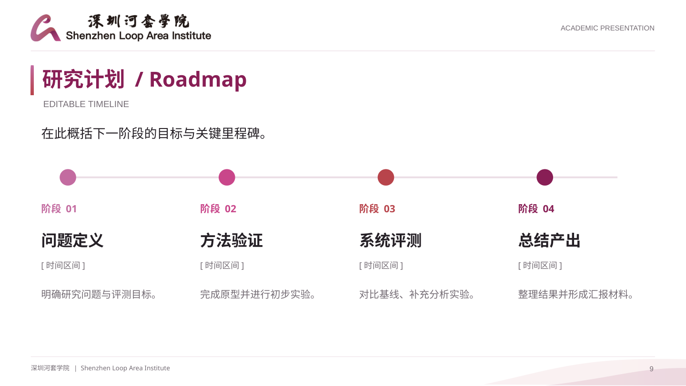

## 10

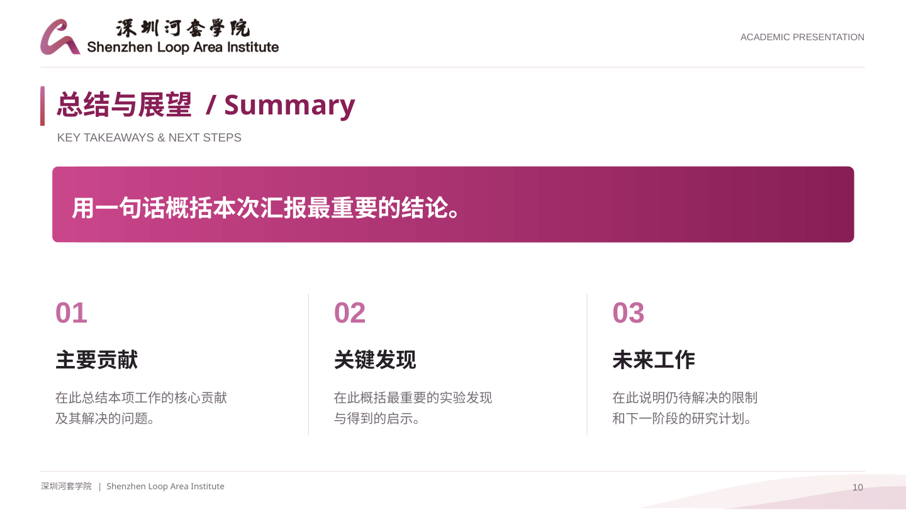

## 11

## 12

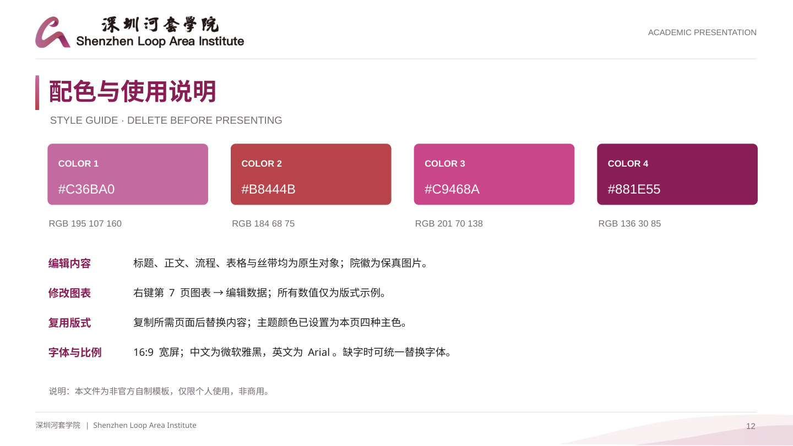
