# 中文 2 · 经典校徽 / Classic

[返回首页 / Back](https://github.com/tjl826/SLAI-PPT/blob/main/README.md)

[下载 PPTX](https://raw.githubusercontent.com/tjl826/SLAI-PPT/main/downloads/zh-02.pptx) · [完整 PDF](https://github.com/tjl826/SLAI-PPT/blob/main/previews/zh-02.pdf) · [缩略图总览](../imgs/zh-02/contact-sheet.jpg)

共 16 页。隐藏页也包含在本预览中，PPTX 原始隐藏状态不变。

预览由 LibreOffice 自动导出；字体替代或图表渲染可能与 PowerPoint 略有差异，以下载的原始文件为准。

## 01

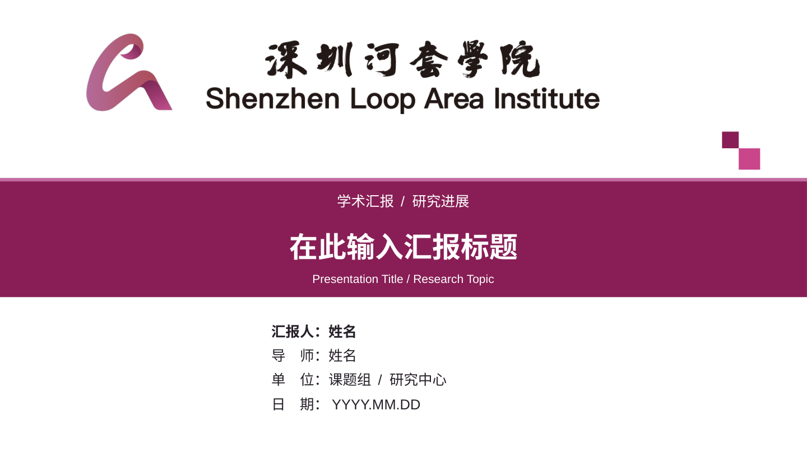

## 02

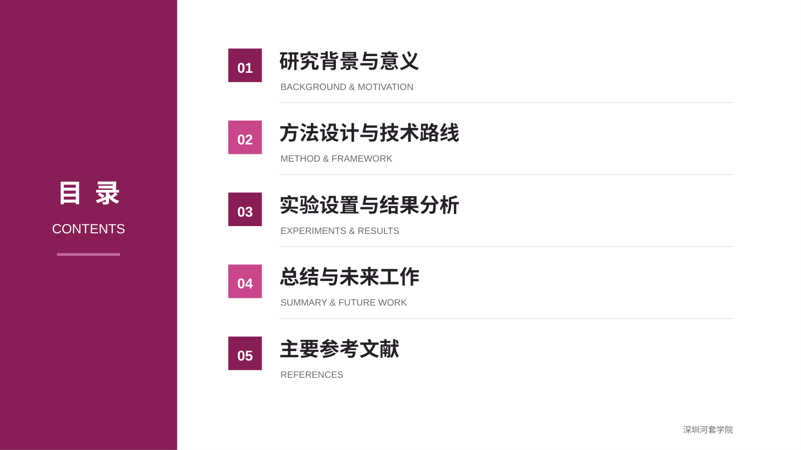

## 03

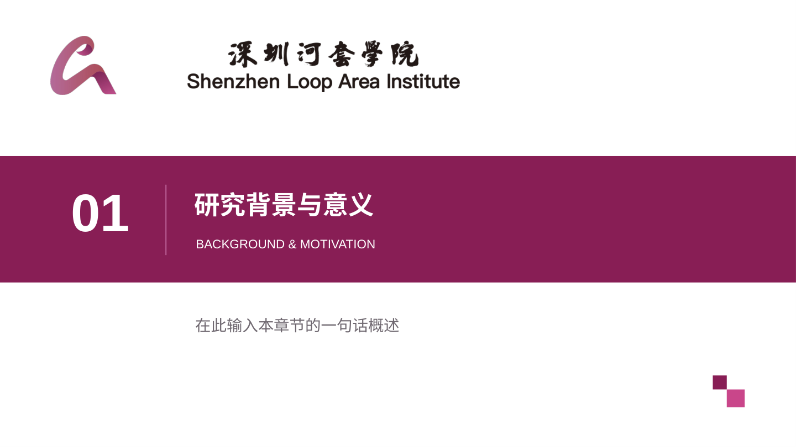

## 04

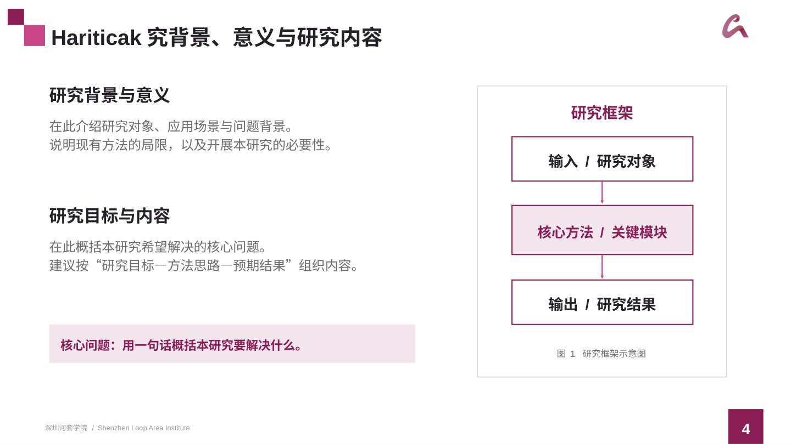

## 05

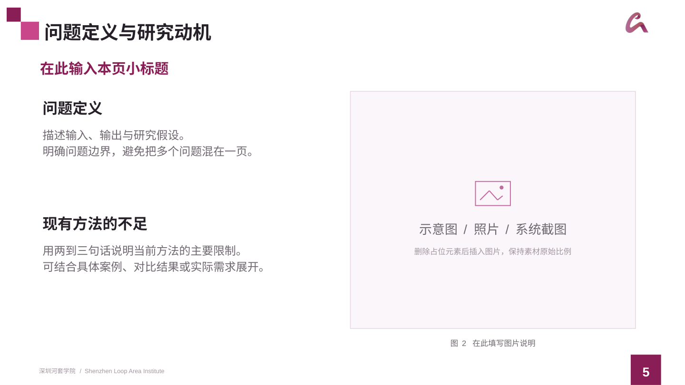

## 06

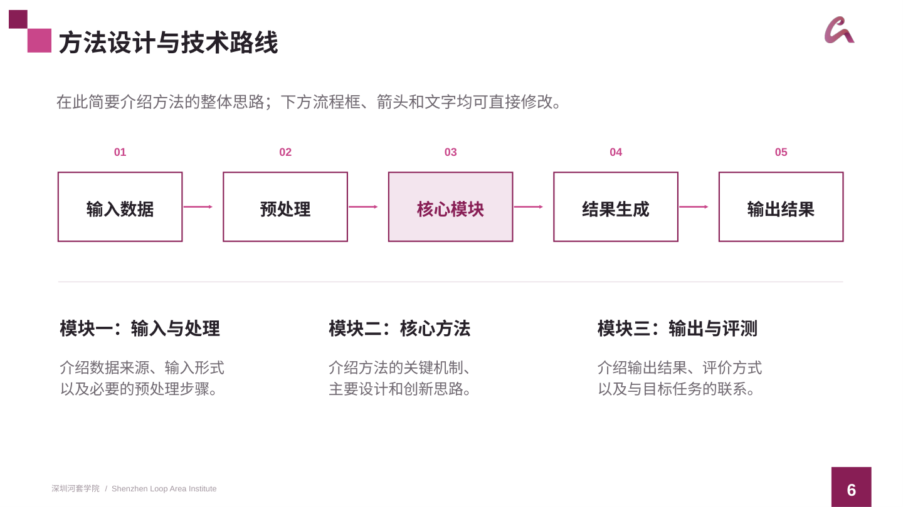

## 07

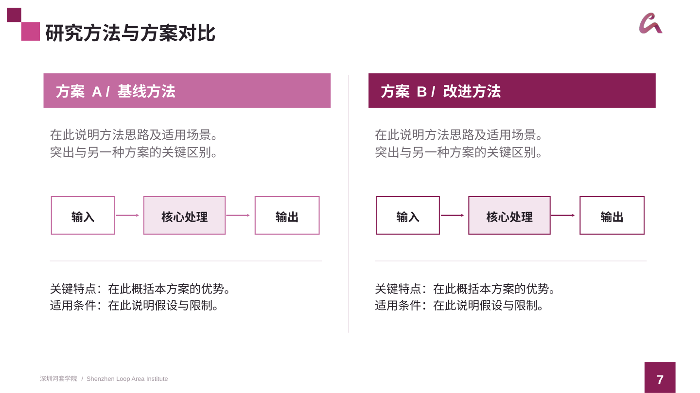

## 08

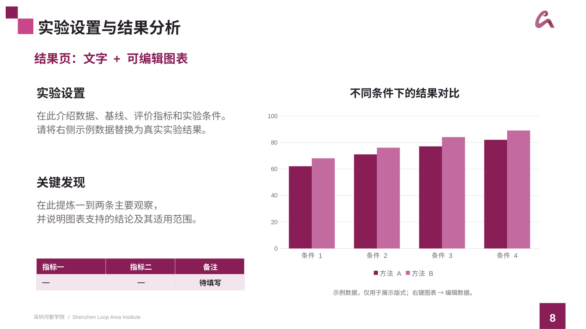

## 09

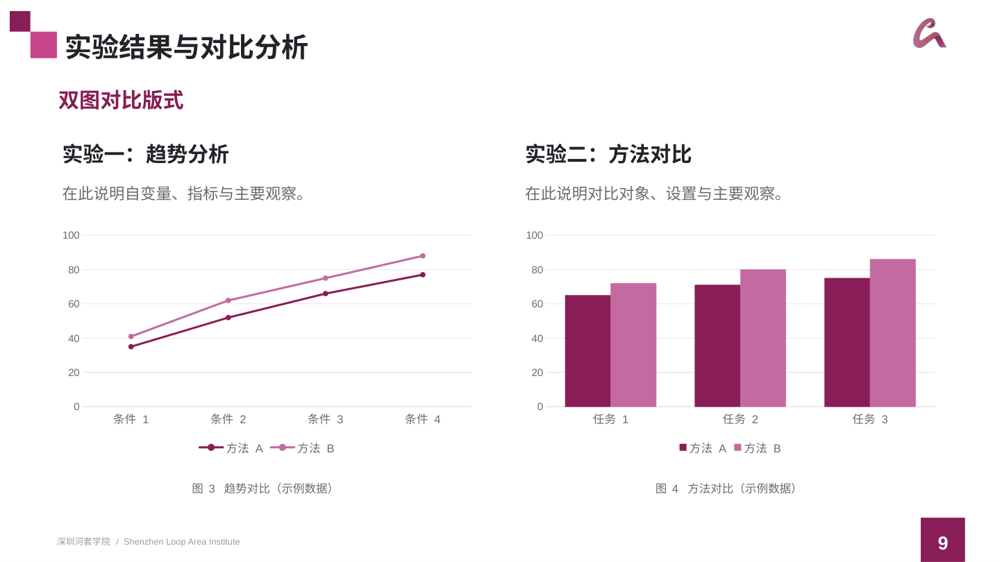

## 10

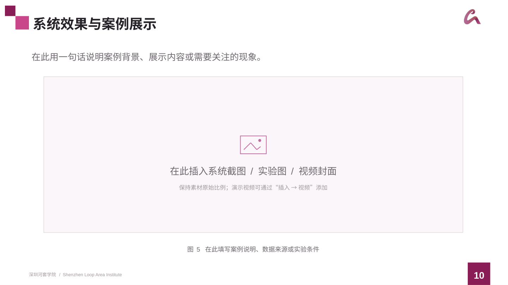

## 11

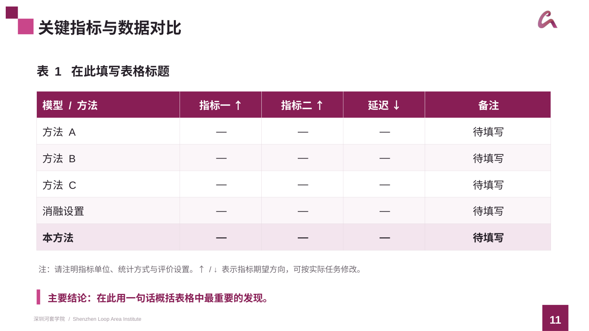

## 12

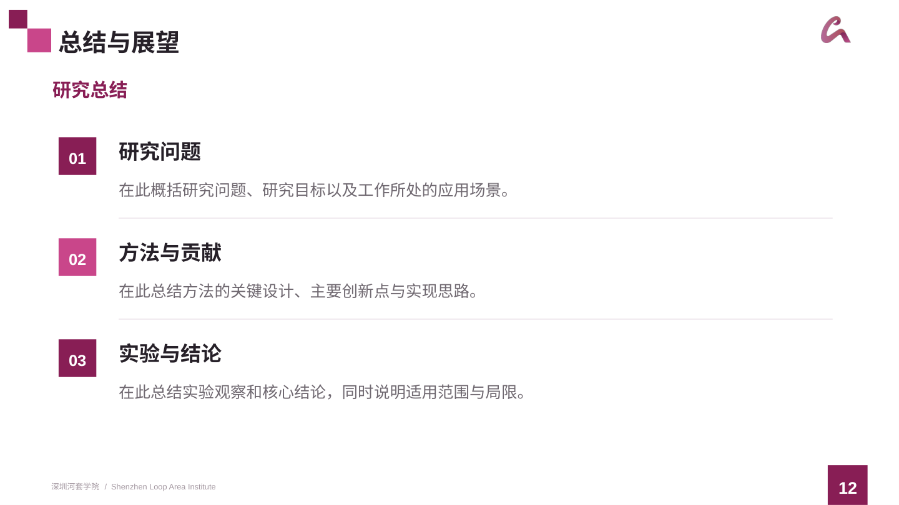

## 13

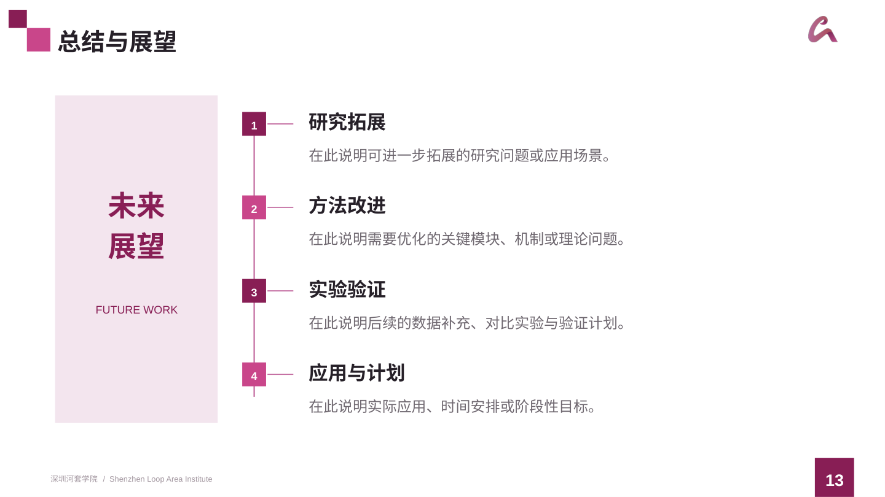

## 14

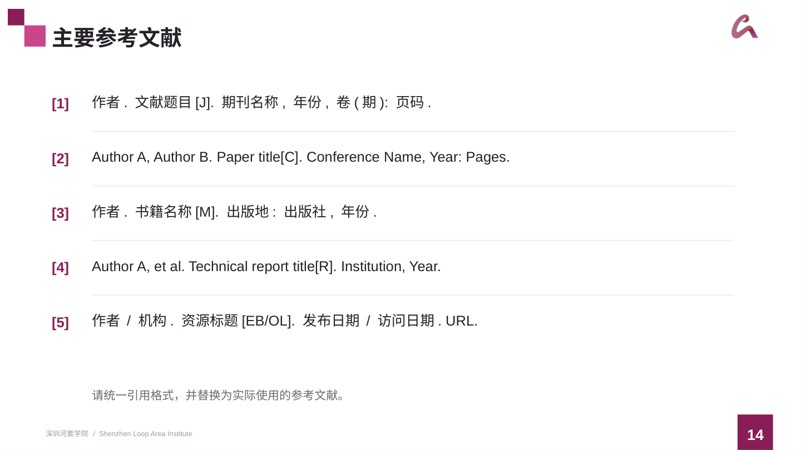

## 15

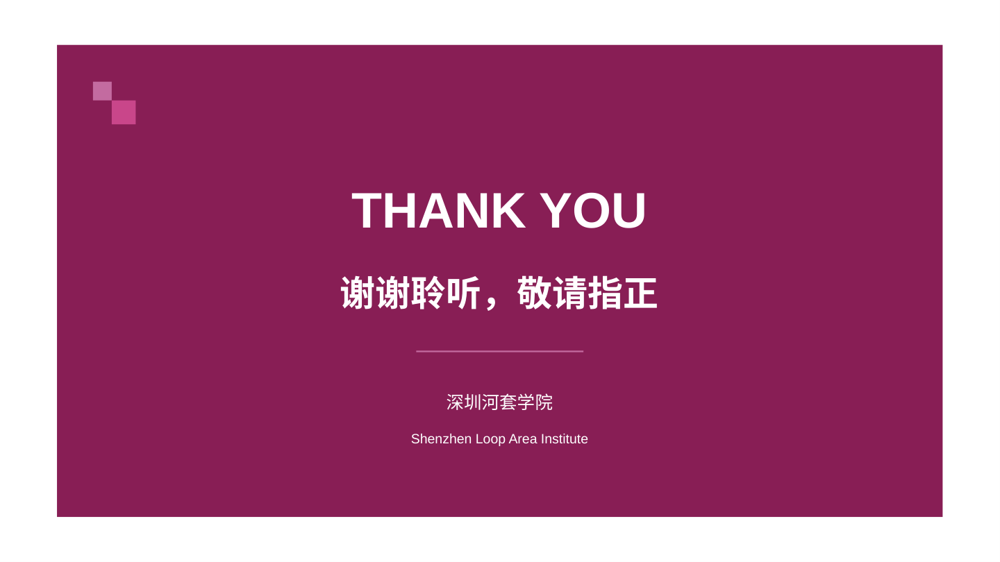

## 16 · 原始文件中为隐藏页 / hidden slide

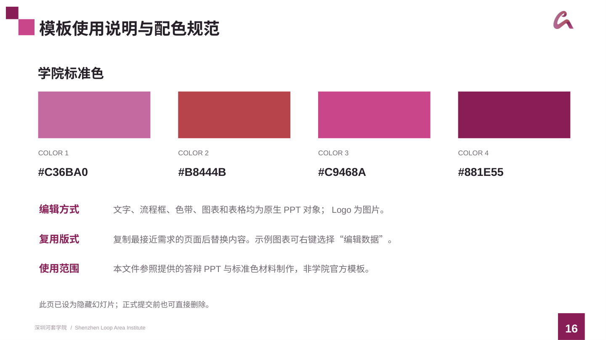
